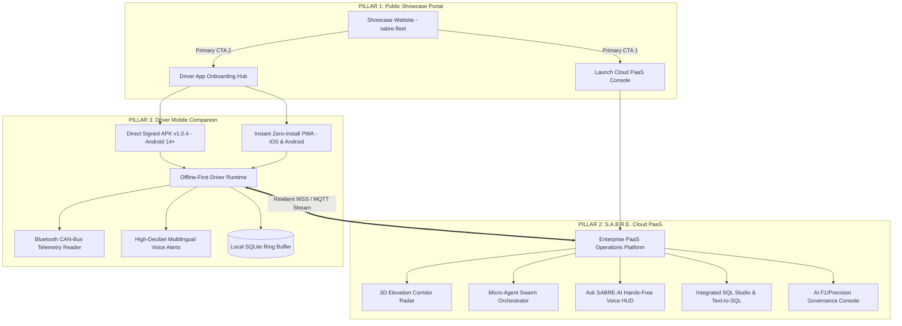
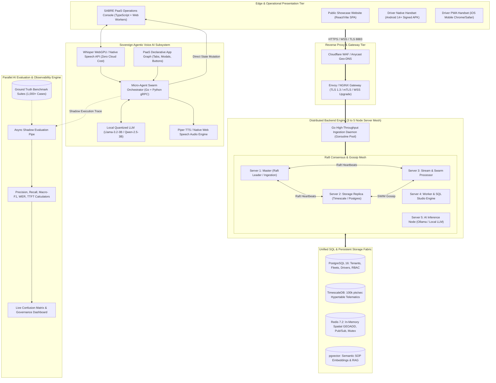
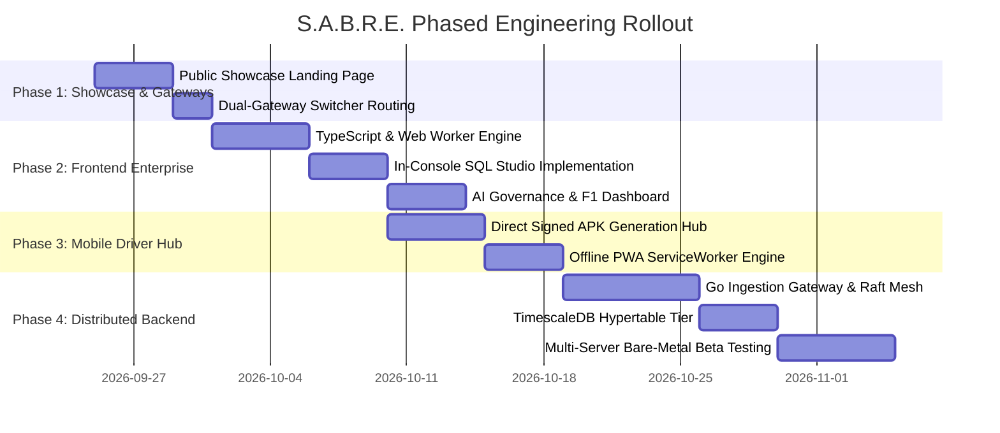

# S.A.B.R.E. Master Engineering & System Architecture Documentation
**System for Autonomous Brake Regulation & Elevation-Adaptive Telematics**  
*Document Version: 2.4.0 (Enterprise Specification)*  
*Platform Target: Windows 10/11 (x64/x86), Android 14+, iOS, Cloud-Native PaaS*

---

## Table of Contents
1. [Executive Summary & Problem Statement](#1-executive-summary--problem-statement)
2. [The Three Ecosystem Pillars](#2-the-three-ecosystem-pillars)
3. [Master System Architecture Diagram](#3-master-system-architecture-diagram)
4. [Pillar 1: Public Showcase Web Portal](#4-pillar-1-public-showcase-web-portal)
5. [Pillar 2: S.A.B.R.E. Cloud PaaS Platform](#5-pillar-2-sabre-cloud-paas-platform)
6. [Pillar 3: Driver Mobile Companion App](#6-pillar-3-driver-mobile-companion-app)
7. [Distributed Multi-Server Backend Engine](#7-distributed-multi-server-backend-engine)
8. [Unified SQL Database Architecture](#8-unified-sql-database-architecture)
9. [Sovereign Agentic Voice AI Engine](#9-sovereign-agentic-voice-ai-engine)
10. [Parallel AI Evaluation & Observability Pipeline](#10-parallel-ai-evaluation--observability-pipeline)
11. [Cross-Platform Hardware Optimization Matrix](#11-cross-platform-hardware-optimization-matrix)
12. [Implementation & Phased Rollout Roadmap](#12-implementation--phased-rollout-roadmap)

---

## 1. Executive Summary & Problem Statement

Commercial heavy vehicle freight operations across steep gradients, mountain passes, and dense logistics corridors face severe systemic challenges:
* **Catastrophic Brake Fade & Runaway Accidents:** Prolonged friction braking on 6%–10% highway descents overheats brake drums beyond 450°C, causing total hydraulic/pneumatic failure.
* **Cellular Blackout Blindspots:** Mountain valleys and tunnels lose cellular coverage for 15–45 minutes, rendering cloud-only telematics completely blind.
* **High Operator Cognitive Load:** Dispatchers juggle fragmented dashboards, phone calls, and manual spreadsheets without real-time predictive safety intervention.

**S.A.B.R.E.** solves this through a unified, sovereign **Platform-as-a-Service (PaaS)** ecosystem featuring:
1. **Real-Time 3D Elevation Corridor Radar:** Physics-based thermal brake modeling synchronized with highway topography and runaway escape ramps.
2. **Local, Zero-Cost Agentic Voice Control:** Completely hands-free natural voice interaction across the PaaS console and in-cabin driver headsets without paid cloud APIs.
3. **Offline-First Driver Safety Engine:** Direct-distributed mobile runtime (no app store gatekeeping) with local SQLite ring buffering.
4. **Distributed Bare-Metal Cluster Mesh:** Scalable across 3 to 5 multi-server nodes running Go and Raft consensus.
5. **Continuous AI Benchmark Auditor:** Mathematical precision, recall, and F1 governance auditing all AI actions in real time.

---

## 2. The Three Ecosystem Pillars



---

## 3. Master System Architecture Diagram



---

## 4. Pillar 1: Public Showcase Web Portal

### Purpose
The public-facing digital storefront designed to convert enterprise logistics companies, fleet owners, and highway infrastructure authorities.

### Core Capabilities
* **Hero Experience:** High-impact visual demonstration of S.A.B.R.E.’s core value proposition: *Autonomous Real-Time Brake Fade Prevention & Agentic Telematics*.
* **Interactive Feature Showcase:**
  * 3D Corridor Elevation Interactive Demo.
  * Real-Time Thermal Heatmap Visualizer.
  * Agentic Voice Command Simulator.
* **The Dual Gateway Hub:**
  1. **[Launch PaaS Console]:** Direct route to the enterprise operations control plane.
  2. **[Driver App Onboarding Hub]:** Direct route to store-free driver app installation.
* **Design Language:** Curated enterprise palette:
  * Background: `#fbf7f2` (delicate skin/off-white tone, zero neon, zero pure-white glare).
  * Structural Chrome: Deep Navy `#1e3a5f`.
  * Accents: Natural Leaf Green `#2e7d32` / `#1b5e20`.
  * Borders: Precise `#000000`.

---

## 5. Pillar 2: S.A.B.R.E. Cloud PaaS Platform

### Purpose
The mission-critical operations control plane for fleet dispatchers, safety auditors, and highway engineers.

### Core Subsystems
1. **3D Elevation & Corridor Radar:**
   * Visualizes vehicle location, highway gradient percentage, and proximity to runaway truck escape ramps.
   * Renders at 60 FPS using hardware-accelerated WebGL vector tiles.
2. **Micro-Agent Swarm Console:**
   * Displays autonomous agent status: *Triage Agent*, *Route Optimizer*, *Thermal Safety Guard*, and *Cold-Chain Monitor*.
   * Shows inter-agent message buses and active interventions.
3. **"Ask SABRE-AI" Hands-Free Context Window:**
   * Natural voice and text interface styled in soft leaf green (`#edf7ee`).
   * Complete programmatic control over the dashboard (navigating tabs, filtering trucks, isolating incidents).
4. **Integrated SQL Studio:**
   * ANSI SQL editor with syntax highlighting, execution explainers, and CSV exports.
   * Integrated Natural Language-to-SQL translation powered by the local AI engine.
5. **AI Governance & F1 Benchmark Dashboard:**
   * Real-time audit dashboard showing Precision, Recall, F1 score, Confusion Matrix, and latency distributions.

---

## 6. Pillar 3: Driver Mobile Companion App

### Purpose
The in-cabin copilot for commercial truck drivers navigating steep descents and treacherous freight corridors.

### Distribution Architecture (100% Store-Free)
* **Path 1: Standalone Signed Android APK (Android 14+):**
  * Direct `.apk` download from the PaaS website with zero Google Play Store dependency.
  * Self-contained native binary compiled with Android Gradle and Hermes bytecode.
  * Background Bluetooth Low Energy (BLE) listener reading OBD-II / J1939 CAN-Bus adapters.
  * In-app Over-The-Air (OTA) updates checking `/api/v1/app/check-update`.
* **Path 2: Enterprise Progressive Web App (PWA) (iOS & Android):**
  * 1-tap install directly from mobile browser to home screen.
  * ServiceWorker caching guaranteeing 100% offline functionality in cellular dead zones.
  * Web Bluetooth, Geolocation, and Web Audio API integration.

### In-Cabin Edge Features
* **Offline Tunnel Buffering:** Sensor packets recorded during dead zones are cached in local SQLite and burst-synced to the PaaS upon network restoration.
* **Hands-Free Multilingual Voice HUD:** High-decibel audio warnings in **Hindi**, **Kannada**, and **English** ("Warning: 8% descent ahead. Shift to Low Gear 2. Brake temperature 410°C!").

---

## 7. Distributed Multi-Server Backend Engine

### Multi-Node Architecture (3 to 5 Bare-Metal Laptops)
For beta testing across physical machines, the nodes form a distributed mesh:

| Machine ID | Allocated Role | Runtime Stack | Responsibilities |
| :--- | :--- | :--- | :--- |
| **Server 1** | **Master & Ingest Gateway** | Go 1.22 + Envoy | Raft Leader, MQTT (8883), WSS (443), Ingress Rate Limiting |
| **Server 2** | **Primary Database Node** | PostgreSQL 16 + TimescaleDB | State storage, write-ahead logging (WAL), multi-tenant schemas |
| **Server 3** | **Replica & In-Memory Hub** | Redis 7.2 Sentinel | Spatial `GEOADD`, Pub/Sub messaging, distributed locks, DB replica |
| **Server 4** | **Swarm Processor & Worker** | Go Worker Pool | Telemetry window aggregations, rule engine, SQL Studio queries |
| **Server 5** | **AI Inference Server** | Ollama / Python 3.11 | Local LLM (Llama-3.2-3B), gRPC worker, vector embeddings |

### Failover & Consensus
* **Raft Consensus Protocol:** If Server 1 goes offline, Server 2 or 3 is elected leader within 1,500ms. Ingest traffic seamlessly fails over with zero data loss.
* **SWIM Gossip Protocol:** Nodes continuously ping peers every 200ms, maintaining cluster latency and load awareness.

---

## 8. Unified SQL Database Architecture

S.A.B.R.E. uses standard **ANSI SQL** across all persistence layers:

```
                            ┌────────────────────────┐
                            │    Go Ingestion Core   │
                            └───────────┬────────────┘
                                        │
           ┌────────────────────────────┼───────────────────────────┐
           ▼                            ▼                           ▼
    ┌──────────────┐             ┌──────────────┐            ┌──────────────┐
    │  PostgreSQL  │             │ TimescaleDB  │            │   pgvector   │
    │  (Relational)│             │ (TimeSeries) │            │ (Embeddings) │
    └──────────────┘             └──────────────┘            └──────────────┘
```

### Relational Schema (PostgreSQL 16)
```sql
-- Multi-Tenant Organizations
CREATE TABLE tenants (
    tenant_id UUID PRIMARY KEY DEFAULT gen_random_uuid(),
    company_name VARCHAR(255) NOT NULL,
    subscription_tier VARCHAR(50) DEFAULT 'enterprise',
    created_at TIMESTAMPTZ DEFAULT NOW()
);

-- Fleet Vehicle Master
CREATE TABLE vehicles (
    vehicle_id VARCHAR(50) PRIMARY KEY,
    tenant_id UUID REFERENCES tenants(tenant_id),
    plate_number VARCHAR(50) NOT NULL UNIQUE,
    vehicle_class VARCHAR(50) NOT NULL, -- e.g. 6-Axle Semi-Trailer
    tare_weight_tons NUMERIC(5,2) NOT NULL,
    max_payload_tons NUMERIC(5,2) NOT NULL,
    max_brake_temp_limit_c NUMERIC(5,2) DEFAULT 450.0,
    created_at TIMESTAMPTZ DEFAULT NOW()
);

-- Driver Master
CREATE TABLE drivers (
    driver_id UUID PRIMARY KEY DEFAULT gen_random_uuid(),
    tenant_id UUID REFERENCES tenants(tenant_id),
    full_name VARCHAR(255) NOT NULL,
    phone_number VARCHAR(50) NOT NULL UNIQUE,
    preferred_language VARCHAR(10) DEFAULT 'en', -- en, hi, kn
    current_vehicle_id VARCHAR(50) REFERENCES vehicles(vehicle_id)
);
```

### High-Throughput Time-Series Schema (TimescaleDB)
```sql
-- Raw Telemetry Hypertable
CREATE TABLE vehicle_telemetry (
    timestamp TIMESTAMPTZ NOT NULL,
    vehicle_id VARCHAR(50) NOT NULL,
    latitude DOUBLE PRECISION NOT NULL,
    longitude DOUBLE PRECISION NOT NULL,
    altitude_m NUMERIC(7,2) NOT NULL,
    speed_kmh NUMERIC(5,2) NOT NULL,
    brake_temp_celsius NUMERIC(5,2) NOT NULL,
    road_gradient_pct NUMERIC(4,2) NOT NULL,
    engine_retarder_pct NUMERIC(4,2) NOT NULL,
    cargo_weight_tons NUMERIC(5,2) NOT NULL
);

-- Convert to Timescale Hypertable partitioned by 12 hours
SELECT create_hypertable('vehicle_telemetry', 'timestamp', chunk_time_interval => INTERVAL '12 hours');

-- Automated Compression Policy after 7 days
ALTER TABLE vehicle_telemetry SET (
    timescaledb.compress,
    timescaledb.compress_segmentby = 'vehicle_id',
    timescaledb.compress_orderby = 'timestamp DESC'
);
SELECT add_compression_policy('vehicle_telemetry', INTERVAL '7 days');
```

---

## 9. Sovereign Agentic Voice AI Engine

### The Zero-Cost Architecture
The voice-controlled agentic capability runs **100% locally** with zero external API fees:

1. **Acoustic Ear (Speech-to-Text):**
   * **In-Browser:** Web Speech API or in-browser Whisper WebGPU running via ONNX.
   * **Latency:** < 100ms transcription latency.
2. **Semantic App Graph (The "Hands"):**
   * Every button, tab, modal, and filter registers an intent into a global declarative schema:
     ```typescript
     interface PaasActionContract {
       id: string;
       description: string;
       parameters: Record<string, 'string' | 'number' | 'boolean'>;
       execute: (params: any) => Promise<ActionResult>;
     }
     ```
3. **The Local Brain (Reasoning):**
   * Local **Llama-3.2-3B-Instruct** or **Qwen-2.5-3B** running on Server 5 via Ollama.
   * Translates spoken commands into strict JSON tool calls:
     ```json
     {
       "action": "FILTER_FLEET_BY_TEMP",
       "parameters": { "threshold_celsius": 400.0 }
     }
     ```
4. **Vocal Output (Text-to-Speech):**
   * Local **Piper TTS** or Web Speech API synthesizing crisp spoken confirmations.

---

## 10. Parallel AI Evaluation & Observability Pipeline

To provide enterprise-grade mathematical verification of the AI's capabilities, an asynchronous shadow evaluation pipeline benchmarks every interaction:

```
[ Operator Voice / Text Input ] ──► [ Agentic Action Plan ]
                                            │
                                            ▼
                           ┌───────────────────────────────────┐
                           │ Async Shadow Evaluation Auditor   │
                           └─────────────────┬─────────────────┘
                                             │
             ┌───────────────────────────────┼───────────────────────────────┐
             ▼                               ▼                               ▼
    [ Intent Precision & F1 ]      [ Slot Extraction F1 ]       [ RAG Hallucination Rate ]
```

### Mathematical Formulations
* **Precision:**
  $$\text{Precision} = \frac{TP}{TP + FP}$$
* **Recall (Sensitivity):**
  $$\text{Recall} = \frac{TP}{TP + FN}$$
* **Macro F1-Score:**
  $$F_1 = 2 \times \frac{\text{Precision} \times \text{Recall}}{\text{Precision} + \text{Recall}}$$
* **Word Error Rate (WER) for Voice:**
  $$\text{WER} = \frac{S + D + I}{N}$$
* **Time to First Token (TTFT):**
  $$\text{Target: } \text{TTFT} < 300\text{ms}$$

All metrics are stored in TimescaleDB and streamed live to the **AI Governance Dashboard**.

---

## 11. Cross-Platform Hardware Optimization Matrix

| Platform | Target OS / Hardware | Engineering Optimization Strategy | Target Frame Rate & Latency |
| :--- | :--- | :--- | :--- |
| **PaaS Operations** | **Windows 10 / 11 (x64 & x86)** | Off-thread **Web Worker** telemetry calculation; hardware-accelerated WebGL vector tiles; virtualized DOM grids. | **60–120 FPS UI**, < 150MB RAM footprint. |
| **Driver App (APK)**| **Android 14+ (Budget/Rugged)** | Standalone signed APK with Hermes V8 bytecode; background BLE daemon; chunked SQLite writes. | **Instant launch**, < 5% battery drain per 8hr shift. |
| **Driver App (PWA)**| **Modern iOS & Android** | Pre-cached ServiceWorker assets; Web Audio singleton context; offline vector corridor tiles. | **Zero-install instant load**, 100% offline tunnel operation. |
| **Public Showcase** | **All Modern Browsers** | Sub-second First Contentful Paint (< 0.8s); zero heavy bloated libraries; responsive CSS tokens. | **Lighthouse Score: 98+**, instant responsive layouts. |

---

## 12. Implementation & Phased Rollout Roadmap



---
*End of Specification — Approved for S.A.B.R.E. Architecture Implementation.*
