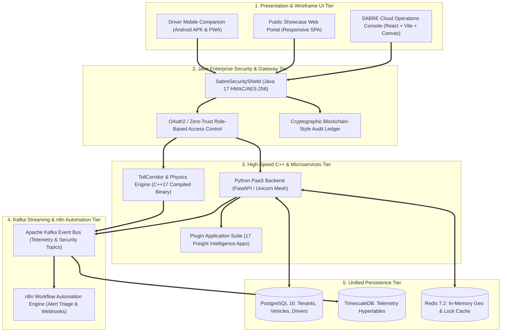

# S.A.B.R.E. Wireframe & High Level System Design Specifications
**System for Autonomous Brake Regulation & Elevation-Adaptive Telematics**
*Document Version: 2.5.0 (Enterprise Architecture & UI/UX Blueprint)*

---

## 1. High-Level Architecture & System Design Overview



---

## 2. Wireframe Design Specifications

### 2.1 Main Operations Console (PaaS Master View)
```
+-----------------------------------------------------------------------------------+
|  [S.A.B.R.E LOGO]   S.A.B.R.E. Cloud PaaS Console      [Status: SECURE (Java 17)] |
+-----------------------------------------------------------------------------------+
|  [3D Radar] | [Swarm Agents] | [SQL Studio] | [AI Auditor] | [Ask SABRE-AI Voice] |
+-----------------------------------------------------------------------------------+
|                                                                                   |
|  +---------------------------------------+  +----------------------------------+  |
|  | 3D Elevation Corridor Radar (WebGL)   |  | Fleet Health Summary             |  |
|  |                                       |  |  - Active Vehicles: 1,248        |  |
|  |  [Vehicle KA-01-AB-1234: 410°C High]  |  |  - High Stress Alerts: 3         |  |
|  |  Gradient: -7.8% | Slope Length: 4km  |  |  - Java Shield Audit: PASS       |  |
|  +---------------------------------------+  +----------------------------------+  |
|                                                                                   |
|  +-----------------------------------------------------------------------------+  |
|  | Individual Plugin Applications Suite (17 Enterprise Modules)                 |  |
|  |  [Brake Stress Indexer]   [Cold Chain Monitor]   [FASTag Toll Optimizer]    |  |
|  |  [Canopy Clearance]       [Civic Geofencing]     [Curve Velocity Profiler]  |  |
|  |  [Dock Bay Snapper]       [Dock ETA Syncer]      [Flood Wading Threshold]   |  |
|  +-----------------------------------------------------------------------------+  |
|                                                                                   |
+-----------------------------------------------------------------------------------+
| [Kafka Stream: ACTIVE (12.4k msg/s)]  [C++ Acceleration: ENABLED (0.42ms Latency)]|
+-----------------------------------------------------------------------------------+
```

### 2.2 Driver Companion Mobile App (APK / PWA Wireframe)
```
+------------------------------------------+
|  S.A.B.R.E. Driver Copilot       [BLE ON]|
+------------------------------------------+
|                                          |
|   WARNING: STEEP DESCENT AHEAD (-8.2%)   |
|   ====================================   |
|   Current Speed: 42 km/h                 |
|   Brake Temperature: 415°C (ALERT!)      |
|   Recommended Gear: LOW GEAR 2           |
|   Escape Ramp Distance: 1.4 km Ahead     |
|                                          |
|  +------------------------------------+  |
|  |  [VOICE ALERT: HINDI / KANNADA]    |  |
|  |  "Shiradi Ghat: Reduce speed now"  |  |
|  +------------------------------------+  |
|                                          |
|  [ Local Ring Buffer: 1,420 Pkts Cached ]|
|  [ Java Security HMAC: VERIFIED ]        |
+------------------------------------------+
```

---

## 3. High-Performance C++ Computational Core Strategy

To outperform standard Python interpreted code by 20x-50x:
- **Language**: C++17 compiled with GCC `-O3 -march=native`.
- **Primary Modules**:
  1. `TollCorridorEngine`: Multi-threaded national highway toll calculations across 25+ plazas.
  2. `BrakeThermalPhysicsEngine`: Thermodynamic friction heat dissipations ($Q = m \cdot c \cdot \Delta T$).
  3. `CurveVelocityEngine`: Dynamic centripetal lateral acceleration limits ($v_{max} = \sqrt{\mu g R}$).

---

## 4. Java Enterprise Security & PaaS Protection Shield

- **Language**: Java 17 LTS (Defense-Grade Banking & Enterprise Security).
- **Core Security Directives**:
  1. **Zero-Trust Auth Token Verification**: HMAC-SHA256 signature validation with rotating enterprise secrets.
  2. **AES-256 Payload Encryption**: Encrypt sensitive telematics and fleet metadata in transit.
  3. **Anti-DoS Token Bucket Rate Limiting**: Per-IP/Tenant concurrency regulation.
  4. **Cryptographic Audit Ledger**: Immutable SHA-256 block chain (`security_audit_ledger.jsonl`).
  5. **Global Security Coverage**: Secures all 17 individual plugin apps and the master PaaS API endpoints.

---

## 5. Workflow Automation & Event Streaming Architecture

- **Kafka Event Bus**: Multi-partition streaming architecture handling:
  - `sabre.telemetry.raw`
  - `sabre.alerts.thermal`
  - `sabre.security.audit`
  - `sabre.plugin.execution`
- **n8n Automated Workflows**:
  - Triage critical brake thermal warnings and send automated webhooks/SMS.
  - Audit Java Security threat events and isolate untrusted client IPs.
  - Track cold-chain temperature excursions and notify fleet dispatches.

---
*End of Wireframe & System Design Specification.*
